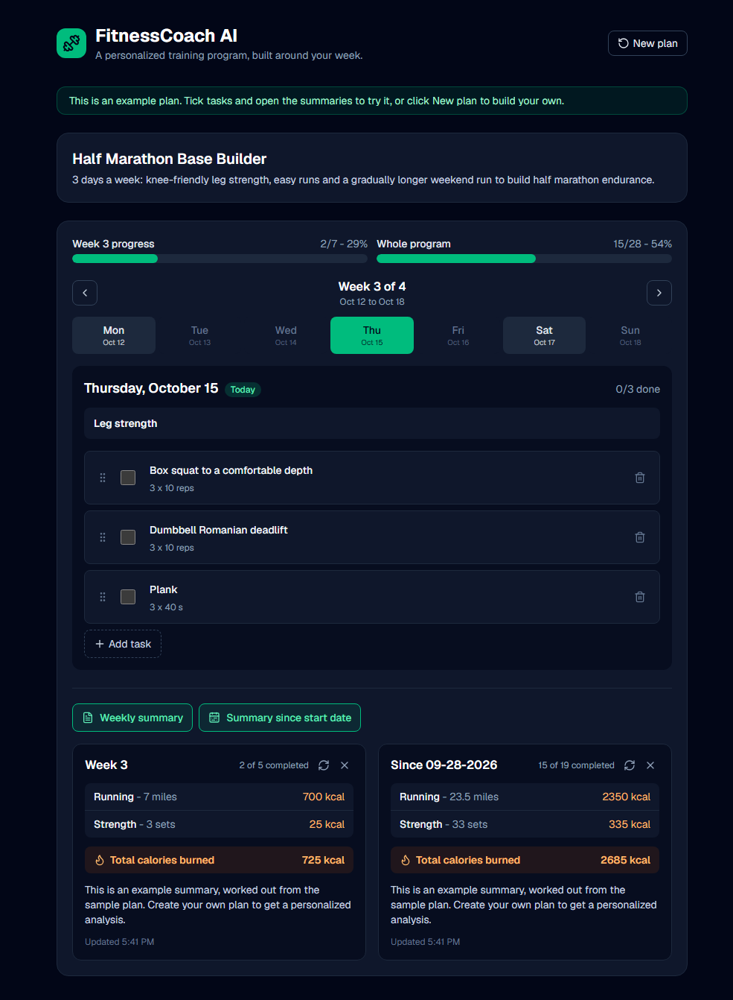
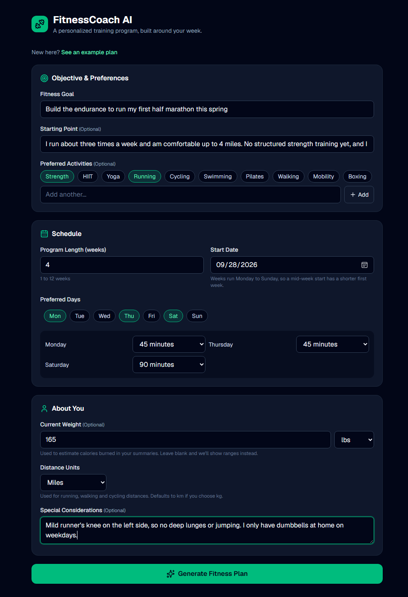
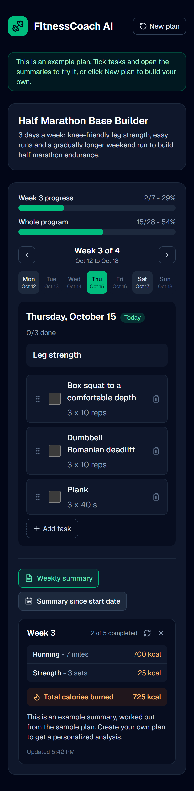

# FitnessCoach AI

An AI fitness coach that turns a short intake form into a personalized, week-by-week training plan, then tracks your progress and summarizes what you actually did. No account or login.

**[Try the live demo](https://fitness-coach-ai-roan.vercel.app/)**

<p align="center">
  
</p>

## What it does

- **Personalized plan from a short form.** Describe a goal, pick your training days and how much time you have on each, and add optional details (starting point, preferred activities, weight, injuries or limits). Claude writes a progressive program around that schedule.
- **A calm, editable dashboard.** Tick tasks off, and see progress for the week and the whole program. Everything is editable in place: rename tasks, change reps or distances, add your own, delete, and drag to reorder.
- **Summaries of what you really did.** Open a weekly summary or a since-start summary: tasks you completed are combined by activity (for example, "Running - 14.6 miles - 1,500 kcal"), with a total and a short note. Calories come from your weight when you give it, or a range when you don't. Open summaries refresh themselves when you change the plan.
- **Works on a phone.** Responsive layout and touch-friendly controls, with text sized so iPhones do not zoom in when you edit.

| Intake form | On a phone |
| --- | --- |
|  |  |

## Try it

Open the [live demo](https://fitness-coach-ai-roan.vercel.app/). You have two ways in:

- **Generate your own plan.** Fill in the form and click **Generate Fitness Plan**. A plan takes about 10 to 20 seconds.
- **See an example first.** Click **"See an example plan"** at the top of the form. It loads a ready-made 4-week half marathon plan with its summaries, with no AI call and no wait. Ticking tasks updates the progress bars and summaries live, so you can try the whole app.

If live generation is ever unavailable (for example, the demo's usage budget is used up), the app says so and the example plan still works.

## How it works

The interesting parts of the build:

- **Fast plan generation.** A whole program in one request took minutes. Each week is now its own small request, run in parallel, and structured JSON output keeps every reply machine-readable. Generating a 12-week plan takes about ten seconds.
- **Recovering from imperfect model output.** Every generated week is validated against the days you asked for. A malformed week is retried automatically (up to three times) instead of failing the whole plan. A week that has nothing to schedule is skipped without a model call.
- **Consistent numbers.** Each task's calories and distance are estimated once from its title and description, saved with the task, and reused by every summary, so the same exercise always gets the same figure. Totals are added up in code, not by the model.
- **One shared cutoff.** Weekly and since-start summaries count tasks through today (or the latest day you checked off, whichever is later), so the weekly figures add up to the since-start total.
- **Calendar weeks.** Weeks run Monday to Sunday, with a shorter first week when you start mid-week. Plans saved under the older layout keep their original dates.
- **Safe by default.** Required-field errors scroll to and focus the first problem. The example plan never touches the API. Real keys stay in `.env.local`, which is git-ignored.

## Tech stack

Next.js 16 (App Router), React 19, TypeScript, Tailwind CSS 4, the Anthropic SDK (Claude), Zod for validation and structured output schemas, dnd-kit for drag and drop, Lucide icons. Tests use Vitest and Testing Library.

## Run it locally

```bash
npm install
cp .env.example .env.local     # then put your Anthropic API key in .env.local
npm run dev                    # http://localhost:3000
```

`ANTHROPIC_API_KEY` is required for live plan generation. Set `ANTHROPIC_MODEL` to use a different Claude model than the default (`claude-sonnet-5-5`). The example plan works without a key.

## Tests

```bash
npm test
```

120 tests cover intake validation, scheduling, plan parsing and retries, summary totals, and the dashboard's behavior. The API tests use a fake Anthropic client, so they cost nothing and need no key.

## Project layout

```
src/app/            page, and the API routes (generate-plan, generate-summary, estimate-tasks)
src/components/     intake form, weekly plan, task list, summaries, confirm dialog
src/lib/            fitness.ts (schemas, scheduling, totals), ai.ts, estimate.ts, sample.ts
src/test/           shared test setup, fixtures and the fake Anthropic client
```

## Product decisions

A few choices made while iterating on the design:

- **Less text, more signal.** No task counts or calories on every row, no "Rest" labels, short plan descriptions. Detail lives in the summaries.
- **No warm-up or stretching tasks unless the goal needs them.** They inflate the progress bar and every person's routine differs.
- **No login.** The plan lives in your browser. That keeps the first minute frictionless, at the cost of no cross-device sync.
- **New plan starts blank.** Prefilling the old answers carried stale dates and goals more often than it saved typing.

## What I'd build next

- Adjust upcoming weeks based on progress ("make next week easier").
- Export or back up a plan, since it lives in one browser.
- Add sessions to a calendar for reminders.

## How it was built

Built with [Claude Code](https://claude.com/claude-code) in VS Code through iterative prompting and review, using Git and GitHub for version control. I directed the product decisions and reviewed the results along the way.
